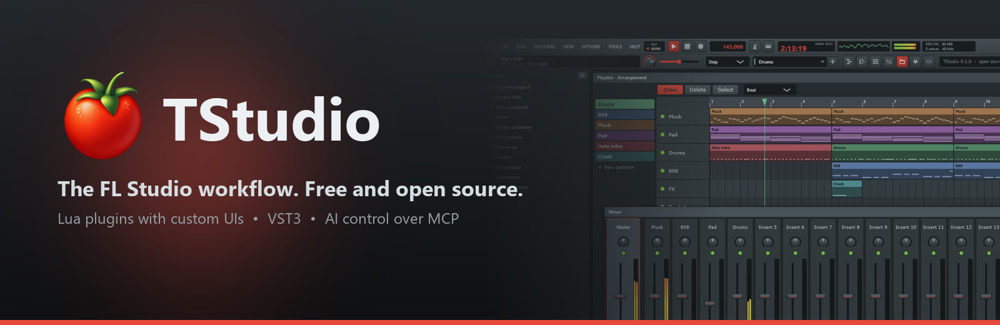
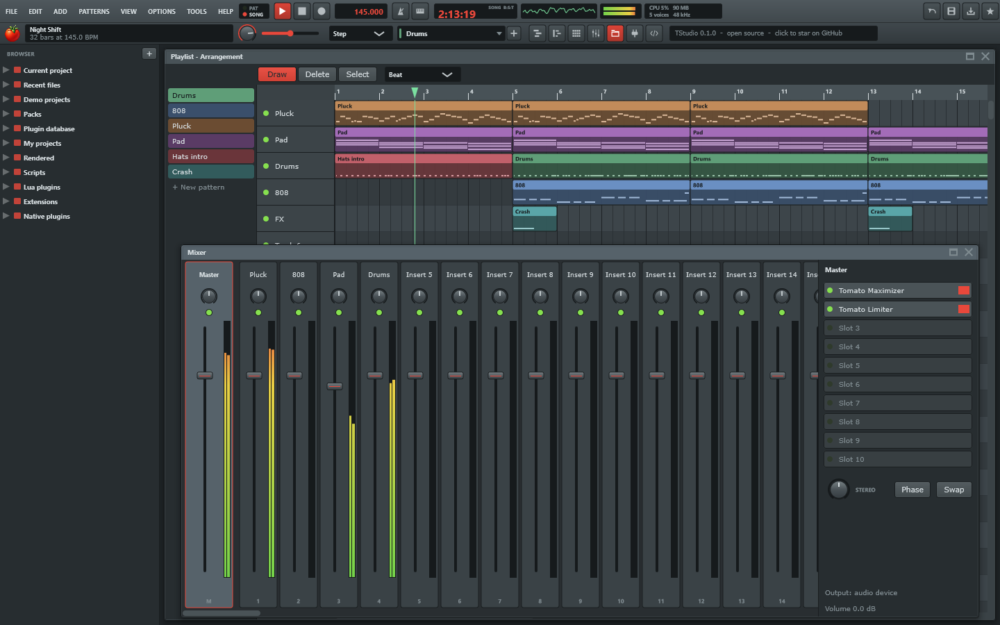
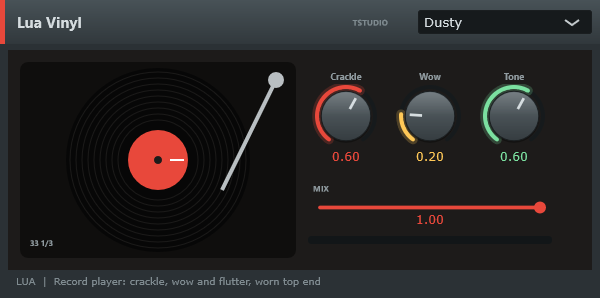
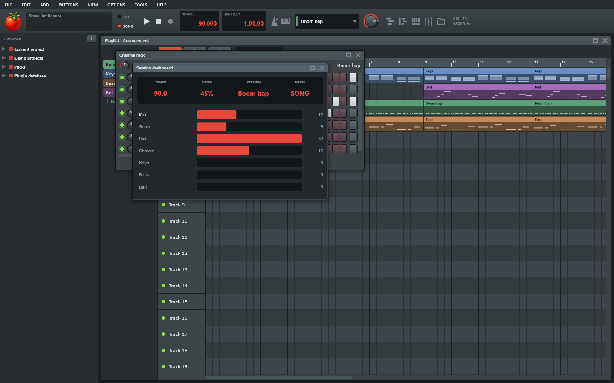
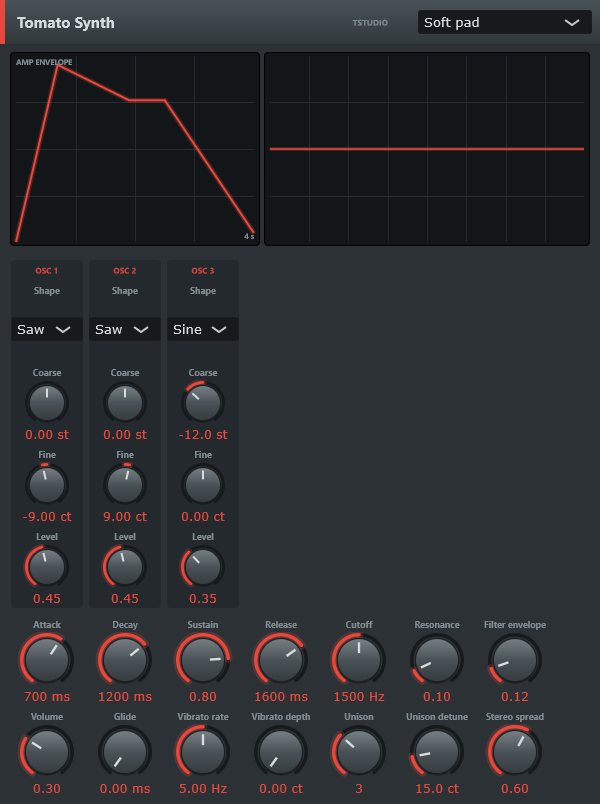
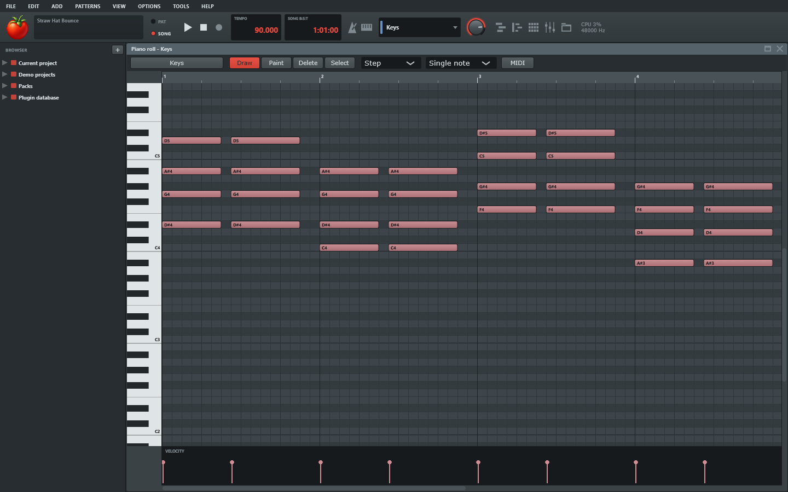
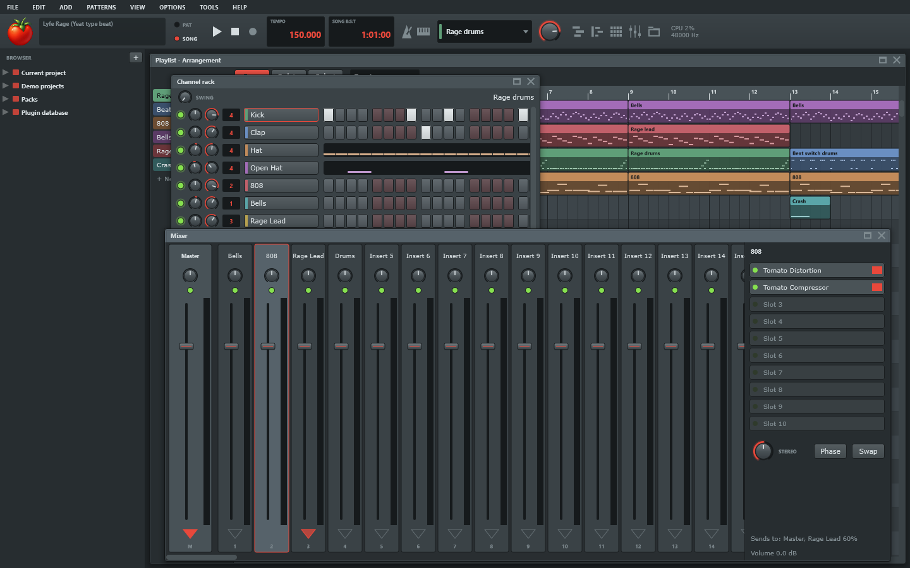

<p align="center"></p>

<p align="center">
  <a href="https://github.com/Luckyz-z/TStudio/releases/latest"></a>
  <a href="https://github.com/Luckyz-z/TStudio/actions/workflows/build.yml"></a>
  <a href="LICENSE"></a>
  <a href="https://github.com/Luckyz-z/TStudio/stargazers"></a>
</p>

<h3 align="center">Channel rack. Piano roll. Playlist. Mixer. The shortcuts you already know.<br>Free forever, open source, and hackable down to the last knob.</h3>

<p align="center">
  <a href="https://github.com/Luckyz-z/TStudio/releases/latest"><b>Download for Windows and Linux</b></a> ·
  <a href="#features">Features</a> ·
  <a href="https://github.com/Luckyz-z/TStudio-Plugins">Plugins</a> ·
  <a href="ROADMAP.md">Roadmap</a> ·
  <a href="CONTRIBUTING.md">Contribute</a>
</p>



## Why TStudio?

You learned to make beats in FL Studio. Your hands know F6, F7, F9, Ctrl+L and the paint brush. TStudio keeps all of that and gives you a DAW you can **open up and change**:

- **Zero relearning.** Same windows, same layout, same shortcuts, and it imports your `.flp` projects.
- **Free and open source.** No trial, no locked features, no "upgrade to save". AGPL-3.0, built in the open.
- **Write your own plugins in an afternoon.** A Lua file with a `process` function is a real instrument or effect, with presets and a custom UI. The same file runs inside FL Studio, Ableton and Reaper through the bundled VST3 loader.
- **Sell what you make.** The plugin exception lets you release free or paid, open or closed plugins. List them in [TStudio-Plugins](https://github.com/Luckyz-z/TStudio-Plugins).
- **Let AI drive it.** Built-in MCP server: ask Claude to write a drum pattern, route a sidechain or render a mixdown.

TStudio is an independent project. It is not affiliated with Image-Line and ships none of their code, art or samples. Every bundled sound is synthesized by TStudio.

## Get started

1. Download TStudio from [Releases](https://github.com/Luckyz-z/TStudio/releases/latest).
   - **Windows:** run `TStudio-x.y.z-Setup.exe`.
   - **Linux:** extract `TStudio-x.y.z-linux-x64.tar.gz` and run `TStudio/TStudio`.
2. TStudio opens with a demo project. Hit **Space**.
3. Browse **Demo projects** in the browser (Alt+F8) and take one apart, or pick **File > New** and start from scratch.

Ten demo projects ship with it, including Straw Hat Bounce, Sun Dreaming, Night Shift and several type beats.

## Features

- **The workflow you know.**
  - **Channel rack:** step sequencer. Channel settings for time shift, per-channel swing, cut groups (closed hat chokes open hat), mono/porta glide, and an arpeggiator.
  - **Piano roll:**
    - ghost notes, chord stamps, velocity lane
    - slide and portamento notes for 808 glides
    - mute and slice tools, scale highlighting with snap-to-scale
    - chop, glue, legato, quantize
  - **Playlist:**
    - pattern clips and **automation clips**: right-click any knob or fader, or use Tools > Last tweaked
    - song loop regions (Ctrl+drag the timeline)
  - **Mixer:** 125 inserts with 10 effect slots each. **Routing between tracks with send levels and sidechain** (FL's send arrows), stereo separation, phase invert and L/R swap.
  - **Everywhere else:**
    - floating windows
    - pattern and song modes
    - typing keyboard to piano
    - recording
    - metronome
  - FL Studio shortcuts throughout (see [docs/KEYBINDINGS.md](docs/KEYBINDINGS.md)).
- **Compatibility.**
  - Opens FL Studio `.flp` projects. Notes (including slides), patterns, playlist, channels, mixer routing and native effects are mapped to Tomato equivalents.
  - Hosts VST3 plugins, with sidechain inputs.
  - The bundled loader VST3s pass all 47 tests of Steinberg's official validator.
  - Imports and exports MIDI. Renders to WAV, FLAC, OGG or **MP3** (320 kbps, LAME built in).
- **Built-in instruments.**
  - Tomato Synth: 3 oscillators, 7-voice unison, glide, filter envelope, 20 presets.
  - Tomato 808, Tomato Pluck, Tomato Keys (FM electric piano), and a Sampler.
  - A 19-piece synthesized drum kit.
- **Built-in effects with their own dashboards:**
  - **EQ and dynamics:** Tomato EQ (7-band, drag the nodes), Compressor (sidechain input, gain-reduction meter), **Multiband** (3-band, OTT-style preset), **Transient**, Limiter, Maximizer, Clipper.
  - **Space and time:** Reverb, Delay, **Glitch** (Gross Beat-style per-step mute, repeat, half-speed, reverse and tape stop).
  - **Tone and colour:** Filter, Distortion (6 modes), **Shaper** (oversampled waveshaper), Bass enhancer, Lofi.
  - **Modulation:** Chorus, **Flanger**, Phaser, Pump (tempo or sidechain-triggered ducking), Gate (16-step), Autopan.
  - **Utility:** Stereo (vectorscope), Scope.
- **Everything is extensible in Lua:**
  - [Scripts](docs/LUA_API.md) edit projects (Tools > Script console, Ctrl+Shift+L).
  - [Extensions](docs/LUA_API.md#extensions) add menu items, shortcuts, event handlers and Lua-drawn panels.
  - [Lua plugins](docs/LUA_PLUGINS.md) are real instruments and effects with presets, meters and **custom UIs** (widgets or a `gfx` drawing API).
  - The same `.lua` plugins also load in any DAW through the bundled **TStudio Lua FX / Lua Synth** VST3 loaders.
- **Native plugins in C.** One header ([SDK/tstudio_plugin.h](SDK/tstudio_plugin.h)) and one exported function, and your DLL shows up as an instrument or effect. See [SDK/README.md](SDK/README.md).
- **AI control over MCP.** Tools > MCP server exposes 38 tools (notes, patterns, mixer routing, automation, rendering, `run_lua`) to Claude and other MCP clients. See [docs/MCP.md](docs/MCP.md).

| Custom Lua plugin UI | Extension panel | Tomato Synth |
| --- | --- | --- |
|  |  |  |

| Piano roll | Mixer |
| --- | --- |
|  |  |

## Make plugins, free or paid

| You want to | Start here |
| --- | --- |
| Make an instrument or effect with a custom UI | [docs/LUA_PLUGINS.md](docs/LUA_PLUGINS.md) and the [templates](https://github.com/Luckyz-z/TStudio-Plugins/tree/main/templates) |
| Add menu items, shortcuts or panels | [Extensions](docs/LUA_API.md#extensions) |
| Write DSP in C, C++, Rust or Zig | [SDK/README.md](SDK/README.md) |
| Control TStudio from an AI assistant | [docs/MCP.md](docs/MCP.md) |
| Share or sell what you made | [TStudio-Plugins](https://github.com/Luckyz-z/TStudio-Plugins) |

Plugins that only use these APIs can use any license, commercial and closed-source ones included. See [LICENSE-PLUGIN-EXCEPTION.md](LICENSE-PLUGIN-EXCEPTION.md).

## Help TStudio grow

- **Star the repo.** It's the single biggest thing that helps other producers find TStudio.
- **Report bugs and missing FL features** with the [issue templates](https://github.com/Luckyz-z/TStudio/issues/new/choose).
- **Build something from the [roadmap](ROADMAP.md).** Linux support, audio clips, a plugin store and more, with good first issues marked.
- **Send a pull request.** Read [CONTRIBUTING.md](CONTRIBUTING.md) first. CI builds and tests every PR.
- **Make a plugin** and list it in [TStudio-Plugins](https://github.com/Luckyz-z/TStudio-Plugins).
- **Post what you made in TStudio** and tag it. Seriously, we want to hear it.

## Build

JUCE 8.0.4, Lua 5.4.7 and LAME 3.100 are fetched automatically.

### Windows

You need Visual Studio 2022 or later (Desktop C++ workload), CMake 3.25+ and Git.

```bash
cmake -S . -B build -A x64
```

```bash
cmake --build build --config Release --parallel
```

### Linux

Tested on Ubuntu 24.04 and 26.04. Install the compiler and JUCE's dependencies:

```bash
sudo apt install build-essential cmake git pkg-config libasound2-dev libjack-jackd2-dev libx11-dev libxext-dev libxrandr-dev libxinerama-dev libxcursor-dev libxcomposite-dev libfreetype-dev libfontconfig1-dev libgl-dev libcurl4-openssl-dev
```

```bash
cmake -S . -B build -DCMAKE_BUILD_TYPE=Release
```

```bash
cmake --build build --parallel
```

Outputs have the same paths without the `.exe` and `.dll` extensions: `build/TStudio_artefacts/Release/TStudio` and `Plugins/TomatoNative.so`. On first launch TStudio adds a desktop entry, an icon and the `.tsp` file type under `~/.local/share`.

### Outputs

The Windows build produces:

| Output | What it is |
| --- | --- |
| `build/TStudio_artefacts/Release/TStudio.exe` | The app. On first launch it registers `.tsp` files with the tomato icon. |
| `build/TStudio_artefacts/Release/Plugins/TomatoNative.dll` | The example native plugin (Native Crusher and Native Sub). |
| `build/TStudioLua{FX,Synth}_artefacts/Release/VST3/` | The Lua loader VST3s for other DAWs. |

To build the installer, install [Inno Setup 6](https://jrsoftware.org/isinfo.php) and compile `installer/TStudio.iss`. It writes `dist/TStudio-0.1.0-Setup.exe`. `python tools/make_installer_art.py` regenerates the installer art and the README banner. Pushing a `v*` tag makes CI build and test on Windows and Linux, then publish a GitHub release with the installer, a portable zip and a Linux tarball.

Build options:

- `-DTSTUDIO_BUILD_LUA_LOADER=OFF` skips the VST3 loaders.
- `-DTSTUDIO_BUILD_NATIVE_EXAMPLE=OFF` skips the example DLL.

## Tests

The integration suite drives the real app through its command line. It renders every demo, every synth preset and every Lua and native plugin, and checks the audio for clipping, NaNs and DC. It also round-trips MIDI, exercises keybindings, extensions and the MCP server, and snapshots every plugin editor.

```bash
python -m pip install numpy
```

```bash
python tests/run_tests.py --exe build/TStudio_artefacts/Release/TStudio.exe
```

On Linux without a display, wrap it in `xvfb-run -a`.

`ctest -C Release` runs the same suite. CI runs it on Windows and Linux for every push and pull request (`.github/workflows/build.yml`).

## Command line

`TStudio.exe project.tsp` opens a project. The options below are mostly for automation and testing:

| Option | Effect |
| --- | --- |
| `--demo NAME` / `--open FILE` | Open a demo or a file. |
| `--lua FILE` | Run a Lua script. Output goes to `tstudio-lua-output.txt`. |
| `--render FILE.wav` | Render the song and quit. |
| `--save FILE.tsp`, `--export-midi FILE`, `--import-midi FILE` | Save, export or import. |
| `--add-plugin FILE.vst3` | Load a plugin (instrument → new channel, effect → insert 1). |
| `--editor NAME [--preset N] --snapshot FILE.png` | Save a picture of a plugin editor. |
| `--view playlist,rack,mixer,pianoroll=NAME,pattern=N,panel=N,play` | Arrange the windows. |
| `--snapshot FILE.png [--delay MS]` | Screenshot the main window. |
| `--press "rack:2;roll:ctrl + U;main:L"` | Send key presses to a view. |
| `--mcp` | Start the MCP server for this session. |
| `--quit` | Exit after the other options run. |

Command-line runs are silent: they never play through your speakers.

## Repository layout

| Path | Contents |
| --- | --- |
| `Source/Engine` | Project model, audio engine, automation API, Lua engine, MCP server, file formats. |
| `Source/Engine/Builtins` | Built-in instruments and effects, Lua plugin host, native plugin host. |
| `Source/Shared` | Lua plugin runtime and UI, shared by the app and the VST3 loader. |
| `Source/UI` | Windows, views, look and feel. |
| `Loader` | The Lua loader VST3. |
| `SDK` | C plugin API and example. |
| `Plugins`, `Scripts`, `Extensions` | Bundled Lua plugins, scripts and extensions (compiled into the app). |
| `Demos`, `tools/make_demos.py` | Demo projects and the generator that writes them. |
| `tests` | Integration tests. |
| `installer` | Inno Setup script and art for the Windows installer. |

See [docs/ARCHITECTURE.md](docs/ARCHITECTURE.md) for how the pieces fit, and [CONTRIBUTING.md](CONTRIBUTING.md) before sending a pull request.

## User folders

TStudio reads these folders under `Documents/TStudio/`:

| Folder | What goes there |
| --- | --- |
| `Scripts/` | Your scripts (Tools > Run script). |
| `Extensions/` | Extensions, loaded at startup (Tools > Extensions > Reload). |
| `Plugins/` | Lua plugins. They also load in the VST3 loaders. |
| `NativePlugins/` | Native C plugin DLLs. |
| `Projects/` | Default save folder. |
| `Rendered/` | Default export folder. |

## License

TStudio is licensed under the [GNU AGPL-3.0](LICENSE), with a [plugin exception](LICENSE-PLUGIN-EXCEPTION.md). It is built with [JUCE](https://juce.com) (AGPLv3) and [Lua](https://www.lua.org) (MIT). FL Studio is a trademark of Image-Line Software.
